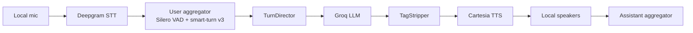

# TrainerTwin take-home: voice interview coach

A Pipecat voice agent that runs a 4-question mock interview out loud. It asks the questions in order, asks at most one follow-up (or gentle hint) per question, and ends with 2–3 lines of spoken feedback.


## How to run it

**Python 3.12.12** (pyenv). Tested on macOS (Apple Silicon).

1. Sign up for the three providers (all have free tiers or credits) and create an API key on each:
   - Deepgram (speech-to-text): https://console.deepgram.com
   - Groq (LLM): https://console.groq.com/keys
   - Cartesia (text-to-speech): https://play.cartesia.ai/keys, and pick a voice at https://play.cartesia.ai/voices
2. Install the system audio library that PyAudio builds against:
   ```bash
   brew install portaudio
   ```
3. Install the Python packages (pinned in `Pipfile.lock`):
   ```bash
   make sync          # or: pipenv sync
   ```
   The Makefile points pipenv at the pyenv env named `dsa` (`VIRTUAL_ENV` at the top). Change that line, or run `pipenv sync` yourself inside any Python 3.12 env.
4. Copy the settings and add your keys:
   ```bash
   cp .env.example .env
   ```
5. **Put headphones on** (the local mic has no echo cancellation, so the agent would hear itself and interrupt), then:
   ```bash
   make run           # = python bot.py
   ```
   The bot greets you and asks question 1. The session ends by itself after the feedback, or with Ctrl+C.
6. After a session:
   ```bash
   make stats         # p50/p95 latency and per-stage averages from latency.jsonl
   ```
   Each run overwrites `latency.jsonl` and `transcript.json`.

## Architecture



Audio comes in from the mic, Deepgram streams transcripts, and the user aggregator decides when your turn is over (Silero VAD for silence, then the smart-turn model for "did they actually finish?"). It then adds your words to the conversation and asks the LLM for a reply. The reply streams sentence by sentence into Cartesia, and the audio plays out. The assistant aggregator records only the words that were actually spoken, so an interrupted reply is stored as far as it got.

**Custom code** (everything else is stock Pipecat):

| File | What it does |
|---|---|
| `interview.py` → `Interview` | Plain state: which question we're on and whether its one follow-up is used. Python, not the LLM, decides the order. |
| `interview.py` → `TurnDirector` | Processor before the LLM. On each user turn it adds one short **session note** to the context ("ask a follow-up or move on to: …"), replacing the previous one. It also tells `Interview` when a reply finished playing or got interrupted, and ends the session after the goodbye. |
| `interview.py` → `TagStripper` | Processor after the LLM. On normal turns the LLM starts its reply with `[FOLLOWUP]` or `[NEXT]`. This reads the tag, records the decision, and removes the tag so it's never spoken. |
| `latency_logger.py` | Pipecat observer (watches frames, not part of the pipeline) that writes `latency.jsonl`. |
| `transcript_logger.py` | Writes `transcript.json` from the aggregators' turn events. |
| `prompts.py` | Every piece of text the LLM sees. See [PROMPTS.md](PROMPTS.md). |

A decision only takes effect once the reply that carries it has **played to the end**. If you cut in (or the reply is cancelled before it plays), the interview stays on the same question. A question can then be asked twice, but it is never skipped.

## Providers and why

| Stage | Provider | Why | Trade-off                                                                                                                                               |
|---|---|---|---------------------------------------------------------------------------------------------------------------------------------------------------------|
| Speech-to-text | **Deepgram** Nova-3 (streaming) | Fast final transcripts (about 0.5s in our logs), good with accented English, $200 free credit | Cannot think of anything major for a demo.                                                                                                              |
| LLM | **Groq** `openai/gpt-oss-120b` | Very fast time to first token (0.2–0.5s in our logs) and follows the session notes and tags reliably. Free tier. | A reasoning model, so it spends 0.2–0.4s "thinking" before the first answer token. Llama on Groq would cut that but follows instructions less reliably. |
| Text-to-speech | **Cartesia** Sonic 3.6 | Lowest time to first audio we know of (TTFB about 0.07s, first audio about 0.2s in our logs), natural voice | Fewer voices than but ok for a demo.                                                                                                                    |
| Transport | Pipecat `LocalAudioTransport` | Nothing to host, no extra accounts | No echo cancellation, so headphones are required                                                                                                        |

## Turn-taking and interruptions

Two silence settings work together:

| Setting | Value | What it does |
|---|---|---|
| `VAD_STOP_SECS` (Silero) | **0.4s** (was 0.2) | Silence after which smart-turn is asked "are they done?" |
| `SMART_TURN_STOP_SECS` | **5s** (default 3) | The longest silence we wait through when smart-turn thinks you're mid-thought |

What went wrong before each change:

1. **Smart-turn's 3s default cut off thinking pauses.** Smart-turn correctly judged an answer `INCOMPLETE`, but after 3s of silence it ended the turn anyway (`End of Turn complete due to stop_secs. Silence in ms: 3000.0`). Interviews have long thinking pauses, so we raised it to 5s. When you clearly finish a sentence, smart-turn still says `COMPLETE` straight away, so this only adds wait time to mid-thought pauses.
2. **Long awkward pauses before the next question.** Because of issue 1, decided to increase the smart turn stop secs to 5. This caused a few awkward pauses (available in logs) but I think it's a fair tradeoff to have.

**Interruptions:** Pipecat 1.16 handles barge-in by default. When the VAD hears you while the bot is speaking, it sends an interruption that stops the LLM, TTS and audio output. Your new words become the next turn. Our part was making the interview state survive it. Two bugs we hit and fixed:

- **Jumped to the next question while the user was still answering.** A false end of turn made the LLM write `[FOLLOWUP]`. The user kept talking, so that reply was cancelled before it played, but the tag had already been counted as "follow-up used". The next turn was then forced to move on.
- **Question 3 was never asked.** `[NEXT]` plus Q3 started playing, the user cut in within milliseconds, and the question counter had already moved on.

The fix for both: decisions wait as `pending` and only apply when the reply plays to the end without being interrupted.


## Latency
Video: https://drive.google.com/file/d/1sZq7jn6JZmsGvrPmVBMeYu_ZjvsCUisp/view?usp=drive_link

| |         |
|---|---------|
| p50 user-stopped → first audio | 3049 ms |
| p95 user-stopped → first audio | 6480 ms |
| avg user stopped → STT final | 209 ms  |
| avg STT final → LLM first token (includes end-of-turn wait) | 3262 ms |
| avg LLM first token → first audio | 107 ms  |

How each field is measured (`latency_logger.py`):

- `user_stopped_ms`: the time the VAD decided you stopped, **minus `VAD_STOP_SECS`**. The VAD only decides after that much silence, so this is when you actually went quiet. If you carry on after a pause, the later stop replaces the earlier one.
- `stt_final_ms`: arrival of the last final Deepgram transcript of the turn.
- `llm_first_token_ms`: first answer token of the reply that actually played. Reasoning tokens and cancelled replies are ignored.
- `tts_first_audio_ms`: when the output transport starts playing the reply (`BotStartedSpeakingFrame`). **Approximation:** it doesn't include the sound card's own output buffer (typically a few tens of ms).
- `interrupted`: you started speaking while that reply was playing.
- Replies cancelled before any audio played don't get a line. The greeting doesn't either, since there's no user turn before it.


## What's weak and what I'd do next

- **A question is timed** Do not want the user to clog time on a single question.
- **Names and jargon.** Deepgram heard "Pipecat" as "pipette", and the coach repeated it ("What part of the pipette logic…"). Next: Deepgram `keyterm` boosting for technical words.
- **A question can be repeated** if you cut in at the very end of it (safer than skipping it, but awkward).
- **Evaluation:** no automated eval of follow-up and feedback quality yet. Next: scripted answers through the same prompts, with an LLM judge scoring relevance.

## Logs and recording

- `latency.jsonl`: one line per turn from the recorded session
- `transcript.json`: who said what, in order (`ms` since session start), with interrupted bot lines marked `"interrupted": true` and holding only the words actually spoken

## AI tools

- **Claude Code**: planning the steps for scaffolding, reading Pipecat 1.16's source to find the relevant APIs, writing first drafts of the code, and reading session logs to find the turn-taking and interview-state bugs. I reviewed, tested, and asked for simplifications throughout. 

## Time spent

About 6-7 hours in total
